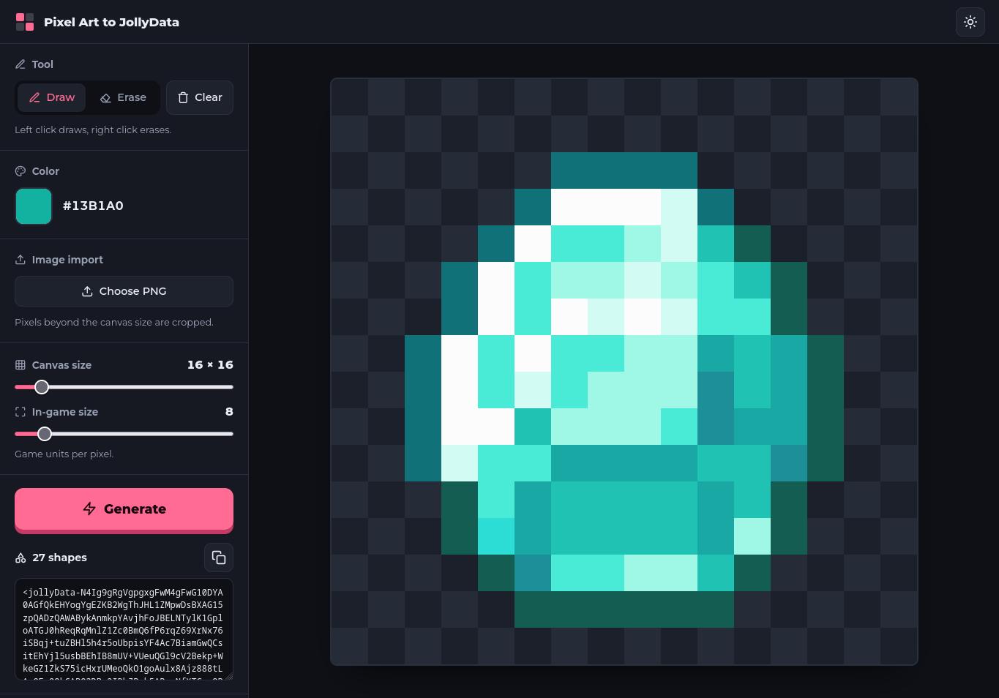

# Pixel Art to JollyData

A lightweight, browser-based pixel-art editor that converts your drawing
into compressed JollyData output.

## Features

-   Draw and erase pixels on a canvas.
-   Choose a drawing color.
-   Adjust the canvas from **4 × 4** to **128 × 128** pixels.
-   Import PNG images (content outside the canvas is cropped).
-   Set the in-game size used to scale pixel coordinates.
-   Generate JollyData output and copy it to the clipboard.
-   Switch between light and dark themes; the selected theme is saved
    locally.
-   Use mouse, touch, or pen input.

## Getting started

1.  Keep the project files together in one directory.
2.  Make sure the required `lzstring.min.js` file is available alongside
    `index.html`.
3.  Open `index.html` in a modern browser.

No build step is required.

## How to use

1.  Draw on the canvas, or choose **Choose PNG** to import an image.
2.  Select **Draw** or **Erase** and choose a color as needed.
    Right-click also erases.
3.  Adjust **Canvas size** and **In-game size**.
4.  Select **Generate**. The generated JollyData string appears in the
    output area and is copied to the clipboard when browser permissions
    allow.
5.  Use the copy button to copy the output again.

## Project files

-   `index.html` --- application structure and controls.
-   `styles.css` --- layout, responsive styling, and light/dark themes.
-   `main.js` --- drawing tools, PNG import, shape generation, and
    output compression.
-   `lzstring.min.js` --- LZ-String compression dependency.
-   `screenshot.png` --- project screenshot displayed at the top of this
    README.

## Notes

-   PNGs are drawn to the current canvas dimensions; pixels outside
    those dimensions are cropped.
-   The initial canvas size is **16 × 16**, and the default in-game size
    is **8 units per pixel**.
-   The output is compressed using LZ-String into a JollyData string.

## Credits

Made with love by [Warze](https://warze.org).
